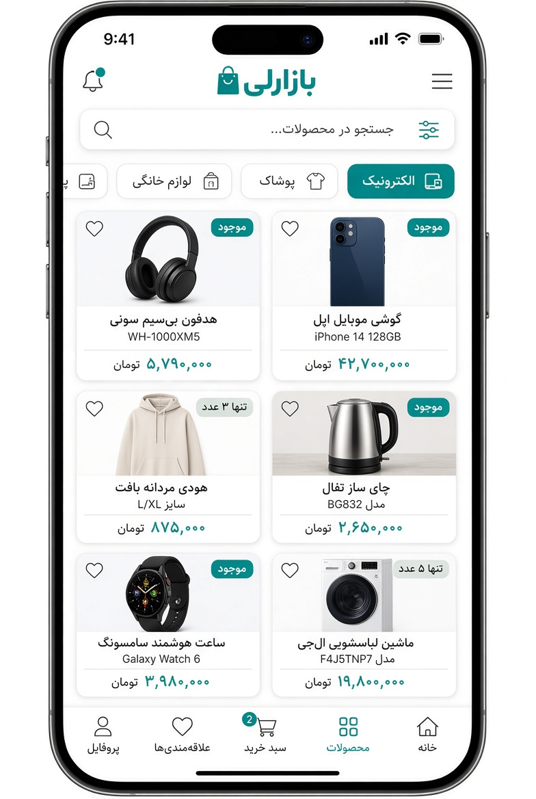

# Bazaarly

A REST API for an online store, built with NestJS, TypeORM and MySQL. It covers the usual shop flow end to end: accounts and roles, a product catalogue, a basket, discount codes, orders, and online payment through Zibal.

I built it as a learning project and wanted it to behave like a real backend, so the parts that usually get skipped (stock handling, order cancellation, payment verification) are implemented rather than stubbed. The [known issues](#known-issues) section lists what is still rough.

## Features

- **Auth**: register and login with a mobile number and password. Login returns an access token and a refresh token (JWT).
- **Roles**: `USER` and `ADMIN`. Catalogue management and discount codes are admin-only.
- **Catalogue**: products and categories (many-to-many).
- **Addresses**: each user manages their own delivery addresses.
- **Basket**: one row per product with a quantity.
- **Bookmarks**: save products for later.
- **Support tickets**: a ticket can have replies; users only see their own.
- **Discount codes**: generated on the server, percentage based, with an expiry time and a usage limit.
- **Orders**: checkout from the basket. Stock is reserved when the order is created and given back if the order is cancelled.
- **Payments**: start a payment with Zibal and confirm it on the callback.
## Screenshots

| Login | Register | Products |
|:---:|:---:|:---:|
|  |  |  |
## Tech stack

| Area | Choice |
| --- | --- |
| Framework | NestJS (TypeScript) |
| Database | MySQL with TypeORM |
| Auth | Passport (JWT strategy), bcrypt |
| Validation | class-validator, class-transformer |
| HTTP client | axios (Zibal requests) |
| Tests | Jest, plus a Postman collection for the API |

Exact versions are in `package.json`.

## Getting started

You need Node.js 22 or newer (I develop on 24) and a running MySQL server.

```bash
git clone https://github.com/benyamin-haghighy/bazaarly-api.git
cd bazaarly-api
npm install
```

Create the database. TypeORM creates the tables on startup (`synchronize: true`) but not the database itself:

```sql
CREATE DATABASE shop;
```

Copy the example environment file and fill it in:

```bash
cp .env.example .env
```

Start the server:

```bash
npm run start:dev
```

The API listens on `http://localhost:3000`.

## Environment variables

| Variable | Description |
| --- | --- |
| `PORT` | Port to listen on. Optional, defaults to `3000`. |
| `DB_HOST`, `DB_PORT` | MySQL host and port. |
| `DB_NAME`, `DB_USERNAME`, `DB_PASSWORD` | Database name and credentials. |
| `ACCESS_TOKEN_SECRETE_KEY` | Secret used to sign access tokens. The spelling matches the code. |
| `ACCESS_TOKEN_EXPIRE` | Access token lifetime, for example `1h`. |
| `REFRESH_TOKEN_SECRET` | Secret used to sign refresh tokens. |
| `REFRESH_TOKEN_EXPIRES_IN` | Refresh token lifetime, for example `7d`. |
| `MERCHANT` | Zibal merchant ID. `zibal` is Zibal's test merchant. |
| `CALLBACK_URL` | URL Zibal sends the user back to after paying. It must be a valid URL that points at `GET /payment/verify`. |
| `VERIFY_URL` | Zibal verify endpoint. |

Use long random strings for both JWT secrets outside local development.

## Scripts

| Command | What it does |
| --- | --- |
| `npm run start:dev` | Run with file watching. |
| `npm run build` | Compile to `dist/`. |
| `npm run start:prod` | Run the compiled build. |
| `npm run lint` | Lint `src/` and `test/`. |
| `npm test` | Run the Jest tests. |

## Project structure

```
src/
  auth/          register, login, JWT strategy
  users/         user entity and user endpoints
  address/       delivery addresses
  category/      categories and the admin strategy
  products/      products
  basket/        basket items
  bookmarks/     saved products
  tickets/       support tickets and replies
  discount-code/ discount codes
  orders/        orders and order items
  payment/       Zibal payment and callback
  main.ts
  app.module.ts
```

Each folder is a Nest module with its own controller, service, DTOs and entities.

## API overview

Protected routes expect `Authorization: Bearer <accessToken>`. "Admin" means the token must belong to a user with the `ADMIN` role.

| Area | Endpoints | Access |
| --- | --- | --- |
| Auth | `POST /auth/register`, `GET /auth/login` | Public |
| Users | `POST /users`, `GET /users`, `GET /users/role/:role`, `GET /users/:id`, `PATCH /users/:id`, `DELETE /users/:id` | Currently public (see known issues) |
| Categories | `POST /category`, `GET /category`, `GET /category/:id`, `PATCH /category/:id`, `DELETE /category/:id` | Admin |
| Products | `GET /products`, `GET /products/:id` | Public |
| | `POST /products`, `PATCH /products/:id`, `DELETE /products/:id` | Admin |
| Addresses | `POST /address`, `GET /address`, `GET /address/:id`, `PATCH /address/:id`, `DELETE /address/:id` | User |
| Basket | `POST /basket`, `GET /basket`, `PATCH /basket/:id`, `DELETE /basket/:id` | User |
| Bookmarks | `POST /bookmarks`, `GET /bookmarks`, `DELETE /bookmarks/:id` | User |
| Tickets | `POST /tickets`, `GET /tickets`, `GET /tickets/:id`, `PATCH /tickets/:id`, `DELETE /tickets/:id` | User |
| Discount codes | `POST /discount-codes/validate` | User |
| | `POST /discount-codes`, `GET /discount-codes` | Admin |
| Orders | `POST /orders`, `GET /orders/status/:status?`, `GET /orders/:id`, `PATCH /orders/:id/cancel`, `DELETE /orders/:id` | User |
| | `PATCH /orders/:id` (change status) | Admin |
| Payment | `POST /payment` | User |
| | `GET /payment/verify` (Zibal callback) | Public |

A few details worth knowing:

- Login is a `GET` request that reads `mobile` and `password` from the JSON body.
- The basket `PATCH` adds the given quantity to the current one; it does not replace it.
- `GET /orders/status` lists every order. Add `/PENDING`, `/PAID` or `/CANCELED` to filter.
- Responses are not uniform yet. Some modules wrap the result as `{ statusCode, data, message }`, others return the entity directly.
- The product description field is spelled `descryption` in the API and database.

### Examples

Register:

```bash
curl -X POST http://localhost:3000/auth/register \
  -H "Content-Type: application/json" \
  -d '{"name": "Sara", "mobile": "09123456789", "password": "Passw0rd123"}'
```

Login:

```bash
curl -X GET http://localhost:3000/auth/login \
  -H "Content-Type: application/json" \
  -d '{"mobile": "09123456789", "password": "Passw0rd123"}'
```

Add to basket:

```bash
curl -X POST http://localhost:3000/basket \
  -H "Authorization: Bearer <accessToken>" \
  -H "Content-Type: application/json" \
  -d '{"product_id": 1, "quantity": 2}'
```

Place an order with a discount code:

```bash
curl -X POST http://localhost:3000/orders \
  -H "Authorization: Bearer <accessToken>" \
  -H "Content-Type: application/json" \
  -d '{"address_id": 1, "discount_code_text": "A3F9C21B"}'
```

## How checkout and payment work

1. The user fills the basket (`POST /basket`).
2. `POST /orders` checks that the basket is not empty and that there is enough stock for every item. It adds up the total, applies the discount code if one was sent, and creates the order as `PENDING`. Each order item stores the unit price at that moment. Stock is reduced, the code is marked as used, and the basket is cleared.
3. A user can only have one `PENDING` order at a time.
4. `PATCH /orders/:id/cancel` cancels a `PENDING` order, puts the stock back and releases the discount code.
5. `POST /payment` asks Zibal for a payment session and returns a `payment_url`. The user pays on that page.
6. Zibal redirects the browser to `CALLBACK_URL` (`GET /payment/verify`) with `success` and `trackId`. The server does not trust those values. It calls Zibal's verify endpoint, then marks the payment `SUCCESS` and the order `PAID`. If the payment failed or was cancelled, the payment becomes `FAILED` and the order is cancelled.

The order total is sent to Zibal as is, and Zibal expects amounts in rials. Store prices in rials, or convert before sending.

Discount codes are created by an admin with `percent`, `valid_for_minutes` and an optional `usage_limit` (default 1). The server generates the code.

## Testing the API

`Bazaarly.postman_collection.json` walks through the whole API: sign-up, admin setup, catalogue, basket, bookmarks, tickets, discount codes, checkout, payment and cleanup.

1. Start the server and make sure the database is reachable.
2. In Postman, import the collection.
3. Open the Collection Runner, select the collection, set the iterations to 1 and run it.

Tokens and ids are stored in collection variables as the run goes, so nothing needs to be filled in by hand. Each run creates its own users with random mobile numbers, so you can run it repeatedly against the same database. The base URL is the `baseUrl` collection variable.

The payment folder needs internet access and a valid `MERCHANT`. The collection simulates a cancelled payment through the callback. To test a successful payment, create an order, call `POST /payment`, open the returned `payment_url` in a browser and complete Zibal's test payment. Zibal will redirect you to `CALLBACK_URL`.

Tests whose names end in `[known bug]` or `[known issue]` describe the behaviour the API should have and will fail until the matching issue below is fixed.

Jest is set up, but the spec files are still the generated defaults.

## Known issues

- `POST /users` is public and accepts a `role`, so anyone can create an admin. The other `/users` routes are public too. They need guards.
- `GET /users` and `GET /users/:id` return the password hash.
- `PATCH /products/:id` only saves when `categories` is sent with at least one id, because of misplaced braces in the service.
- `POST /payment` is missing its JWT guard, so `req.user` is undefined and the request fails.
- `PATCH /orders/:id` looks the order up by the admin's own user id, so an admin cannot update other people's orders.
- Order creation is not wrapped in a database transaction, and the stock check and the stock update are separate steps. Two simultaneous orders can oversell a product.
- A refresh token is issued at login, but there is no endpoint that uses it.
- Login should be a `POST`.
- `synchronize: true` is on. Switch to migrations before deploying anywhere real.

## Author

Benyamin ([@benyamin-haghighy](https://github.com/benyamin-haghighy))
